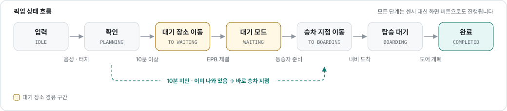
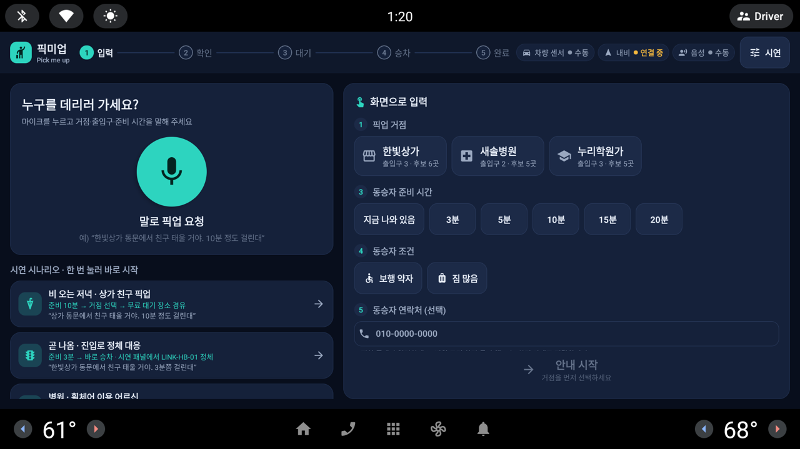
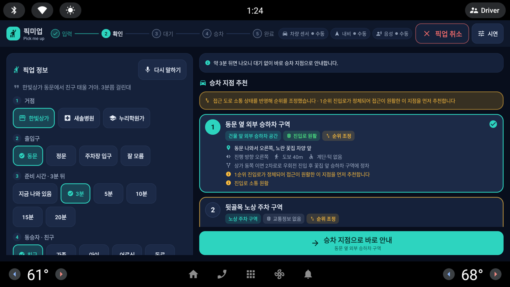
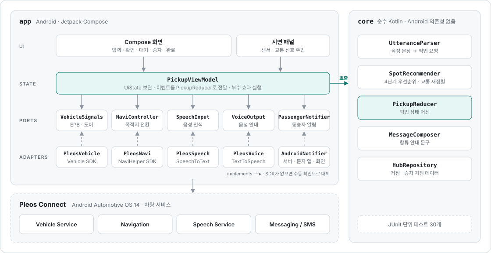

<div align="center">


<h1>픽미업 &nbsp;<sub><sup>Pick me up</sup></sub></h1>

**기다리는 곳과 태우는 곳을 나눠 안내하는 Pleos Connect 차량용 픽업 앱**

Kotlin &nbsp;·&nbsp; Jetpack Compose &nbsp;·&nbsp; Android Automotive OS 14 &nbsp;·&nbsp; Pleos Connect SDK

[APK 다운로드](#apk) &nbsp;|&nbsp; [실행 방법](#실행-방법) &nbsp;|&nbsp; [시연 시나리오](#시연-시나리오) &nbsp;|&nbsp; [아키텍처](#아키텍처) &nbsp;|&nbsp; [테스트 환경](#테스트-환경)

<br/>


</div>

<br/>

## 개요

누군가를 데리러 가는 주행은 건물 앞에 도착한다고 끝나지 않습니다. 동승자가 나올 때까지 어딘가에서 기다렸다가, 차를 댈 수 있는 곳에서 태워야 끝납니다. 하지만 지금의 내비게이션은 건물 주소 하나만 안내하고, 나머지는 운전자가 현장에서 판단합니다. 그 결과가 도로변 비상등 대기, 정차할 곳을 찾는 배회 주행, 운전 중 휴대폰 검색입니다.

픽미업은 하나였던 목적지를 **기다리는 곳(대기 장소)** 과 **태우는 곳(승차 지점)** 으로 나누고, 둘 사이의 전환을 차량이 처리합니다.

| | 기존 내비게이션 | 픽미업 |
| --- | --- | --- |
| 목적지 | 건물 주소 하나 | 대기 장소 → 승차 지점, 두 단계 |
| 일찍 도착했을 때 | 운전자가 직접 정차 위치 판단 | 직행 후 시간 여유가 10분 이상이면 대기 후보를 비교 |
| 승차 위치 | 건물 앞 아무 곳 | 4단계 우선순위와 진입로 소통 상태로 고른 지점 |
| 동승자 준비 완료 시 | 운전자가 목적지를 다시 입력 | 내비 목적지가 승차 지점으로 자동 전환 |
| 단계 판단 | 수동 | 주차 브레이크(EPB) · 도어 개폐 신호 |

## 동작 방식

<picture>
  <source media="(prefers-color-scheme: dark)" srcset="docs/assets/flow-dark.svg">
  
</picture>

| 단계 | 하는 일 | 사용하는 차량 기능 |
| --- | --- | --- |
| 입력 | 운전자가 마이크 버튼을 누르거나 화면을 터치했을 때만 동작합니다. “한빛상가 동문에서 친구 태울 거야. 10분 정도 걸린대”에서 거점, 출입구, 준비 시간, 동승자 조건을 읽어 냅니다. | SpeechToText |
| 확인 | 승차 지점을 4단계 우선순위(주행차로 옆 승차 공간 → 건물 앞 외부 승하차 공간 → 노상 주차 구역 → 주차장)로 정렬합니다. 진입로가 정체면 대체 지점을 올리고 이유를 표시하며, 교통정보가 없는 골목은 `교통정보 없음`으로 표시합니다. 보행 약자는 계단·턱 지점을 빼고, 짐이 많으면 도보 거리를 더 크게 반영합니다. | — |
| 대기 | 준비 예정 시각에서 현재 시각과 직행 예상 시간을 뺀 여유가 10분 이상이면 대기 후보를 찾습니다. 우회 시간을 뺀 실제 대기 가능 시간을 기준으로 무료 → 일부 무료 → 유료 순으로 안내합니다. 직행 5분과 후보 경유 시간은 시연용 추정이며 차량 위치나 실제 도로 경로를 사용하지 않습니다. 도착해 주차 브레이크를 채우면 대기 모드로 바뀌고, 동승자에게 합류 위치를 보냅니다. | NaviHelper · Vehicle |
| 전환 | 동승자 준비 신호(또는 카운트다운 종료)를 받으면 내비 목적지를 승차 지점으로 바꿉니다. | NaviHelper |
| 완료 | 승차 지점에서 도어 개폐를 감지하면 픽업을 마칩니다. | Vehicle |

동승자 알림은 **픽미업 서버 문자 → 차량 문자 앱 → 화면 안내** 순으로 시도합니다. 센서나 SDK를 쓸 수 없는 환경에서도 모든 단계에 수동 확인 버튼이 있어 흐름이 멈추지 않습니다.

## 화면

<table>
  <tr>
    <td width="50%"></td>
    <td width="50%"></td>
  </tr>
  <tr>
    <td><sub><b>입력</b> — 음성 또는 터치로 거점·출입구·준비 시간 지정</sub></td>
    <td><sub><b>진입로 정체</b> — 순위 조정과 그 이유 표시</sub></td>
  </tr>
  <tr>
    <td width="50%"></td>
    <td width="50%"></td>
  </tr>
  <tr>
    <td><sub><b>대기 모드</b> — EPB 감지, 준비 카운트다운, 합류 안내</sub></td>
    <td><sub><b>완료</b> — 도어 개폐 감지로 탑승 확인</sub></td>
  </tr>
</table>

차량 디스플레이 가로 화면 기준 좌우 2단 레이아웃입니다. 터치 영역은 76dp 이상, 주요 버튼은 화면당 1~2개로 제한했고, 주행 중(EPB 해제 확인 시)에는 키보드 입력과 문자 앱 전환을 막습니다. 1000dp · 1600dp 기준 반응형이라 세로형·멀티 윈도우에서는 1단으로 재배치됩니다.

## 아키텍처

<picture>
  <source media="(prefers-color-scheme: dark)" srcset="docs/assets/architecture-dark.svg">
  
</picture>

두 개의 Gradle 모듈로 나뉩니다.

- **`core` — 순수 Kotlin 도메인.** 음성 문장 해석, 승차 지점 추천, 픽업 상태 머신, 합류 안내 문구를 담습니다. Android 의존성이 없어 JVM에서 바로 테스트하며, 단위 테스트 30개가 있습니다.
- **`app` — Android 애플리케이션.** Compose 화면과 `PickupViewModel`, 그리고 차량 연동을 위한 포트와 어댑터로 구성됩니다.

설계에서 지킨 세 가지 원칙은 다음과 같습니다.

1. **단방향 상태 흐름.** 모든 상태 변경은 `PickupEvent`를 `PickupReducer`에 넣어 새 `PickupState`를 얻는 한 경로로만 일어납니다. 차량 센서, 화면 버튼, 시연 패널이 같은 이벤트를 쓰기 때문에, 실제 차량이 없어도 같은 흐름을 재현할 수 있습니다.
2. **포트와 어댑터.** ViewModel은 `VehicleSignals`, `NaviController`, `SpeechInput`, `VoiceOutput`, `PassengerNotifier` 인터페이스만 알고, Pleos SDK 호출은 `platform/pleos` 어댑터 안에 둡니다. SDK 서비스가 없는 기기에서는 어댑터가 `UNAVAILABLE`을 알리고 화면은 수동 확인으로 대체합니다.
3. **명시적 요청과 최소 권한.** 음성 인식은 마이크 버튼을 눌렀을 때 한 번만 동작하고, 마이크는 Pleos Speech Service가 다루므로 앱은 `RECORD_AUDIO`·`SEND_SMS`를 요청하지 않습니다.

```
pickmeup-app
├── core/                    순수 Kotlin 도메인 + 단위 테스트
│   ├── model/               Hub · PickupSpot · PickupRequest · RankedSpot
│   ├── domain/              UtteranceParser · SpotRecommender · PickupReducer · MessageComposer
│   └── data/                시연용 거점 데이터 (SampleHubRepository)
├── app/
│   ├── ui/                  Compose 화면 · PickupViewModel · 시연 패널
│   └── platform/            포트(Ports.kt) · Pleos 어댑터(pleos/) · 동승자 알림
├── apk/                     release APK
└── docs/                    ARCHITECTURE.md · 다이어그램 · 화면 캡처
```

상세 계약과 상태 전이는 [docs/ARCHITECTURE.md](docs/ARCHITECTURE.md)에 정리했습니다.

## APK

| | |
| --- | --- |
| 파일 | [`apk/PickMeUp_PickMeUp_release.apk`](apk/PickMeUp_PickMeUp_release.apk) — release 빌드, 서명됨 |
| 다른 경로 | [GitHub Release v1.0.0](../../releases/tag/v1.0.0) |
| 패키지 | `com.pickmeup.app` · versionName `1.0.0` · minSdk 28 · targetSdk 34 |

## 실행 방법

**APK로 설치**

```bash
adb install -r apk/PickMeUp_PickMeUp_release.apk
```

Pleos Connect Emulator를 띄운 뒤 위 명령으로 설치하고, 앱 목록에서 **픽미업**을 실행합니다.

**소스에서 빌드**

```bash
./gradlew :core:test            # 도메인 단위 테스트
./gradlew :app:assembleRelease  # release APK (서명 키가 없으면 debug 키로 서명)
```

JDK 17과 Android SDK Platform 34가 필요합니다. Pleos Connect SDK는 `settings.gradle.kts`에 등록된 Pleos Maven 저장소에서 받습니다. Android Studio에서 프로젝트 폴더를 열어 실행해도 됩니다.

## 시연 시나리오

화면 오른쪽 위 **시연** 버튼을 누르면 주차 브레이크, 도어, 내비 도착, 접근 도로 교통 상태를 직접 바꿀 수 있는 패널이 열립니다. 실제 차량이나 Virtual Console 없이 전체 흐름을 볼 수 있습니다.

**비 오는 저녁, 상가에서 친구를 태우는 경우 — 대기 장소 경유**

1. 홈의 시연 카드 “상가 동문에서 친구 태울 거야. 20분 정도 걸린대”를 누릅니다.
2. 거점 후보 중 **한빛상가**를 고르면 무료 대기 장소와 승차 지점이 추천됩니다.
3. **대기 장소로 안내** → 시연 패널 **주차 브레이크 체결** → 대기 모드로 바뀌고 합류 안내가 표시됩니다.
4. **동승자 준비 완료** → 승차 지점 안내 → **도착** → 시연 패널 **도어 열림** → 완료.

**곧 나오는데 진입로가 막힌 경우 — 순위 조정**

1. 시연 카드 “한빛상가 동문에서 친구 태울 거야. 3분쯤 걸린대”를 누릅니다.
2. 시연 패널에서 `LINK-HB-01`을 두 번 눌러 정체로 바꾸면, 1순위 지점이 내려가고 대체 지점이 이유와 함께 올라옵니다.

그 밖에 “새솔병원 정문에서 할머니 모시고 갈게. 휠체어 타셔. 십 분 정도 걸린대”(보행 약자 조건), “누리학원가 후문, 딸이 이미 나와 있대”(대기 없이 바로 승차)도 준비되어 있습니다.

## 테스트 환경

| 항목 | 값 |
| --- | --- |
| 대상 에뮬레이터 | **Pleos Connect Emulator v2.1.0** — `system-images;android-34;pleos_car_emulator`, Android 14 (API 34) |
| 화면 규격 | **1920 × 1080 px, 160 dpi** (가로형, 1920 × 1080 dp) |
| 동작 검증 | Android Automotive 에뮬레이터 (API 33, arm64, 1920 × 1080 / 160 dpi)에서 위 시연 시나리오 전체를 크래시 없이 확인했습니다. 이 환경에는 Pleos 서비스가 없어 SDK 상태가 `수동`으로 표시되고, 시연 패널과 수동 버튼으로 진행됩니다. |
| AVD 권장 설정 | Automotive 디바이스, Cold boot, RAM 4 GB (Pleos 개발 가이드 권장값) |
| Pleos Connect SDK | Vehicle 2.3.2 · NaviHelper 3.0.5 · SpeechToText 3.3.1 · TextToSpeech 3.3.1 |
| 빌드 도구 | Android Gradle Plugin 8.5.2 · Gradle 8.9 · Kotlin 1.9.25 · JDK 17 · Jetpack Compose (Material 3) |

<details>
<summary><b>선택 설정</b> — 없어도 실행됩니다</summary>

<br/>

비밀값은 저장소에 넣지 않았습니다. 필요하면 프로젝트 루트에 `secrets.properties`(`.gitignore` 대상)를 만듭니다.

```properties
# Pleos Playground > My Project > SDK 클라이언트 ID·시크릿 (서버 음성 인식·합성용)
PLEOS_CLIENT_ID=
PLEOS_CLIENT_SECRET=
# 동승자 알림용 픽미업 문자 서버 (POST {"to": "...", "text": "..."})
SMS_SERVER_URL=
```

- 클라이언트 ID가 없으면 음성 인식·합성은 차량 내장(ON_DEVICE) 모드로 동작하고, 그마저 안 되면 화면 입력으로 진행합니다.
- 문자 서버 주소가 없으면 차량 문자 앱에 합류 안내를 채워 열고, 연락처가 없으면 화면에 합류 안내 문구를 띄웁니다.
- 자체 서버 소스는 제출 범위에 포함하지 않았습니다.

</details>

<details>
<summary><b>권한</b></summary>

<br/>

| 권한 | 용도 |
| --- | --- |
| `pleos.car.permission.CAR_DOORS` | 도어 개폐 감지 — 탑승 완료 |
| `pleos.car.permission.CAR_SAFETY` | 경고등 정보로 주차 브레이크(EPB) 체결 감지 — 대기 모드 |
| `pleos.car.permission.NAVI_ROUTE_SEARCH` | 기본 내비 목적지 설정·취소 |
| `pleos.car.permission.NAVI_ROUTE` | 경로·도착 이벤트 수신 |
| `pleos.car.permission.STT_SERVICE` · `TTS_SERVICE` | 음성 인식 · 음성 안내 |
| `android.permission.INTERNET` | 픽미업 문자 서버 (선택) |

차량 마이크 음성은 외부 음성 인식 서비스로 보내지 않습니다.

</details>

## 알려진 제약

- 거점·승차 지점 데이터(한빛상가, 새솔병원, 누리학원가)는 **시연용 가상 데이터**이며 현장 확인을 거치지 않았습니다. 실제 서비스에서는 지자체 도로·주차장 공공데이터와 현장 확인으로 구축합니다.
- 공개 SDK에 실시간 교통정보 API가 없어, 시연에서는 접근 도로별 소통 상태를 시연 패널로 설정합니다.
- Vehicle SDK 2.3.2에는 주차 브레이크 상태 API가 따로 없어 경고등(`ELECTRONIC_PARKING_BRAKE`) 정보로 판단하며 1초 간격으로 조회합니다.
- 동승자의 준비 완료 신호는 시연에서 버튼과 카운트다운으로 대신합니다.
- 주행 중 사용 선언(Distraction Optimized)은 하지 않았습니다. 주행 중에는 플랫폼 주행 규제 정책을 따르며, CarUxRestrictions 연동 후 선언할 계획입니다.

<br/>

<div align="center"><sub>현대자동차그룹 차량용 앱 개발 공모전 출품작</sub></div>
