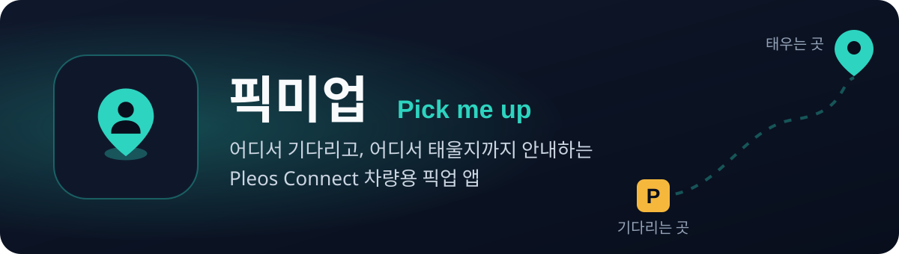
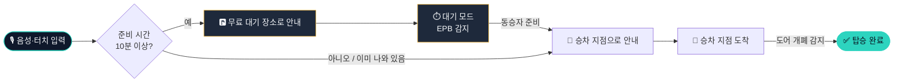
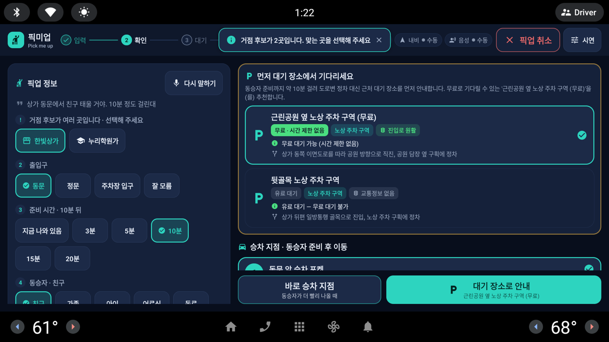
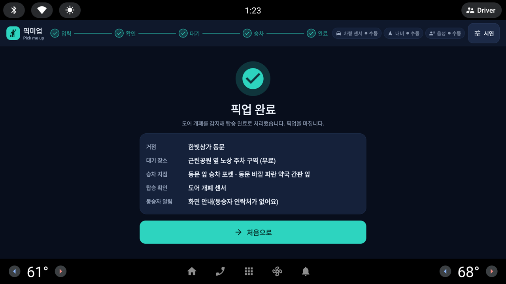
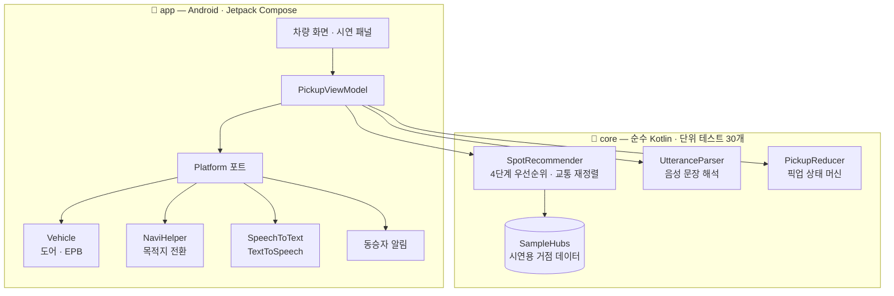

<div align="center">



<br/>


**동승자를 데리러 갈 때 무료 대기 장소를 안내하고,<br/>동승자가 준비되면 차량 진입과 승차가 가능한 지점으로 내비 안내를 전환하는 Pleos Connect 차량용 앱**

[📦 APK 받기](#-apk) · [🚀 실행 방법](#-실행-방법) · [🎬 2분 시연](#-2분-시연-시나리오) · [🧪 테스트 환경](#-테스트-환경)

<sub>현대자동차그룹 차량용 앱 개발 공모전 출품작</sub>

</div>

<br/>

## 💡 왜 필요한가요?

누군가를 데리러 가는 길은 **건물 앞에 도착했다고 끝나지 않습니다.** 동승자가 나올 때까지 어딘가에서 기다렸다가, 차를 댈 수 있는 곳에서 태워야 비로소 끝납니다. 그런데 지금의 내비게이션은 *건물 주소* 하나만 안내합니다.

<table>
<tr>
<th width="33%">😣 지금은</th>
<th width="33%">✅ 픽미업은</th>
<th width="33%">🚗 차량이라서 가능한 것</th>
</tr>
<tr valign="top">
<td>도로변 비상등 대기, 정차할 곳을 찾는 배회 주행, 운전 중 휴대폰으로 주차장 검색</td>
<td>목적지를 <b>기다리는 곳</b>과 <b>태우는 곳</b>으로 나누고, 그 사이 전환을 앱이 대신 처리</td>
<td>주차 브레이크(EPB)로 대기 모드 진입, 도어 개폐로 탑승 완료, 기본 내비 목적지 자동 전환</td>
</tr>
</table>

## ✨ 주요 기능

| | 기능 | 설명 | SDK |
| :-: | --- | --- | --- |
| 🎙️ | **명시적 요청 기반 입력** | 마이크 버튼이나 화면 터치로 요청했을 때만 동작합니다.<br/>“한빛상가 동문에서 친구 태울 거야. 10분 정도 걸린대” → 거점·출입구·준비 시간·동승자 조건 해석 | `SpeechToText` |
| 🥇 | **4단계 우선순위 추천** | ① 주행차로 옆 승차 공간 → ② 건물 앞 외부 승하차 공간 → ③ 노상 주차 구역 → ④ 주차장<br/>보행 약자는 계단·턱 지점 제외, 짐이 많으면 도보 거리 가중 | core |
| 🚦 | **진입로 교통 반영** | 1순위 진입로가 정체면 대체 지점을 올리고 **이유를 표시**합니다. 골목은 `교통정보 없음`으로 표시하고 기본 순위 유지 | core |
| 🅿️ | **무료 대기 장소 안내** | 준비 시간 10분 이상이면 무료 → 일부 무료 → 유료 순으로 대기 장소 제안, 10분 미만이면 바로 승차 지점으로 | `NaviHelper` |
| ⏱️ | **대기 모드** | 주차 브레이크 체결을 감지하면 동승자 준비 카운트다운과 승차 지점까지 예상 시간 표시 | `Vehicle` |
| 🔀 | **승차 지점 자동 전환** | 동승자 준비 신호(또는 카운트다운 종료) 시 내비 목적지를 승차 지점으로 변경 | `NaviHelper` |
| 💬 | **동승자 알림** | ① 픽미업 서버 문자 → ② 차량 문자 앱에 합류 안내 채우기 → ③ 화면에 합류 안내 문구 크게 표시 | — |
| 🚪 | **탑승 완료** | 승차 지점에서 도어 개폐를 감지하면 픽업 종료 | `Vehicle` |
| 🔊 | **음성 안내** | 단계가 바뀔 때 짧은 음성 안내 | `TextToSpeech` |

> [!NOTE]
> 센서나 SDK를 읽지 못하는 환경에서도 모든 단계에 **수동 확인 버튼**이 있어 흐름이 멈추지 않습니다.

## 🔄 픽업 흐름



## 📱 화면

<table>
<tr>
<td width="50%"><p align="center"><b>홈</b> · 마이크 또는 터치로 픽업 요청</p></td>
<td width="50%"><p align="center"><b>확인</b> · 무료 대기 장소와 승차 지점 추천</p></td>
</tr>
<tr>
<td width="50%"><p align="center"><b>진입로 정체</b> · 순위 조정과 이유 표시</p></td>
<td width="50%"><p align="center"><b>대기 모드</b> · EPB 감지, 카운트다운, 합류 안내</p></td>
</tr>
<tr>
<td width="50%"><p align="center"><b>탑승 완료</b> · 도어 개폐 감지</p></td>
<td width="50%" valign="middle">

**화면 설계 원칙**

- 가로형 차량 디스플레이 기준 좌우 2단 레이아웃
- 터치 영역 76dp 이상, 주요 버튼은 화면당 1~2개
- 주행 중(EPB 해제 확인 시) 키보드 입력과 문자 앱 전환 차단
- 1000dp · 1600dp 기준 반응형 — 세로형·멀티 윈도우에서는 1단으로 재배치

</td>
</tr>
</table>

## 📦 APK

| 항목 | 내용 |
| --- | --- |
| 파일 | [`apk/PickMeUp_PickMeUp_release.apk`](apk/PickMeUp_PickMeUp_release.apk) (release 빌드, 서명됨) |
| 다른 경로 | [GitHub Release v1.0.0](../../releases/tag/v1.0.0)에 같은 파일 |
| 패키지 | `com.pickmeup.app` · versionName `1.0.0` · minSdk 28 · targetSdk 34 |

## 🚀 실행 방법

### APK로 바로 설치

1. Pleos Connect Emulator를 실행합니다 ([테스트 환경](#-테스트-환경) 참고).
2. APK를 설치합니다.
   ```bash
   adb install -r apk/PickMeUp_PickMeUp_release.apk
   ```
3. 에뮬레이터 앱 목록에서 **픽미업**을 실행합니다.

### 소스에서 빌드

```bash
git clone <이 저장소 주소>
cd pickmeup-app
./gradlew :core:test            # 도메인 로직 단위 테스트 (30개)
./gradlew :app:assembleDebug    # 디버그 APK
./gradlew :app:assembleRelease  # release APK (서명 키가 없으면 debug 키로 서명)
```

- JDK 17, Android SDK Platform 34가 필요합니다. Android Studio에서 프로젝트 폴더를 열어 실행해도 됩니다.
- Pleos Connect SDK는 `settings.gradle.kts`에 등록된 Pleos Maven 저장소에서 받습니다.

## 🎬 2분 시연 시나리오

> [!TIP]
> 오른쪽 위 **`시연`** 버튼을 누르면 차량 신호(주차 브레이크·도어·내비 도착)와 접근 도로 교통 상태를 직접 바꿀 수 있는 패널이 열립니다. 실제 차량이나 Virtual Console 없이도 전체 흐름을 볼 수 있습니다.

**🌧️ 비 오는 저녁, 상가에서 친구 픽업 (대기 장소 경유)**

1. 홈에서 시연 카드 **“상가 동문에서 친구 태울 거야. 10분 정도 걸린대”** 를 누릅니다 (또는 마이크로 말하기).
2. 거점 후보 중 **한빛상가**를 고르면 무료 대기 장소와 승차 지점이 추천됩니다.
3. **대기 장소로 안내** → 시연 패널 **주차 브레이크 체결** → 대기 모드 (카운트다운 · 합류 안내).
4. **동승자 준비 완료** → 승차 지점으로 내비 전환 → **도착** → 시연 패널 **도어 열림** → 탑승 완료.

**🚦 곧 나오는데 진입로가 막힐 때**

1. 시연 카드 **“한빛상가 동문에서 친구 태울 거야. 3분쯤 걸린대”** 를 누릅니다.
2. 시연 패널에서 `LINK-HB-01`을 두 번 눌러 **정체**로 바꾸면, 1순위 지점이 내려가고 대체 지점이 이유와 함께 올라옵니다.

<details>
<summary><b>다른 시연 문장</b></summary>

| 문장 | 보여 주는 것 |
| --- | --- |
| “새솔병원 정문에서 할머니 모시고 갈게. 휠체어 타셔. 십 분 정도 걸린대” | 보행 약자 조건 — 계단·턱 있는 지점 제외 |
| “누리학원가 후문, 딸이 이미 나와 있대” | 동승자가 이미 나와 있으면 대기 없이 바로 승차 지점 |

</details>

## 🧪 테스트 환경

| 항목 | 값 |
| --- | --- |
| 대상 에뮬레이터 | **Pleos Connect Emulator v2.1.0** (`system-images;android-34;pleos_car_emulator`, Android 14 / API 34) |
| 화면 규격 | **1920 × 1080 px, 160 dpi** (가로형, 1920 × 1080 dp) |
| 동작 검증 | Android Automotive 에뮬레이터 (API 33, arm64, 1920 × 1080 / 160 dpi)에서 위 시연 시나리오 전체를 크래시 없이 확인했습니다. 이 환경에는 Pleos 서비스가 없어 SDK 상태가 `수동`으로 표시되고, 시연 패널·수동 버튼으로 진행됩니다. |
| AVD 권장 설정 | Automotive 디바이스, Cold boot, RAM 4 GB (Pleos 개발 가이드 권장값) |
| Pleos Connect SDK | Vehicle 2.3.2 · NaviHelper 3.0.5 · SpeechToText 3.3.1 · TextToSpeech 3.3.1 |
| 빌드 도구 | Android Gradle Plugin 8.5.2 · Gradle 8.9 · Kotlin 1.9.25 · JDK 17 · Jetpack Compose (Material 3) |

<details>
<summary><b>⚙️ 선택 설정 (없어도 실행됩니다)</b></summary>

<br/>

비밀값은 저장소에 포함하지 않았습니다. 필요하면 프로젝트 루트에 `secrets.properties`를 만들어 넣습니다 (`.gitignore` 대상).

```properties
# Pleos Playground > My Project > SDK 클라이언트 ID·시크릿 (서버 음성 인식·합성용)
PLEOS_CLIENT_ID=
PLEOS_CLIENT_SECRET=
# 동승자 알림용 픽미업 문자 서버 (POST {"to": "...", "text": "..."})
SMS_SERVER_URL=
```

- 클라이언트 ID가 없으면 음성 인식·합성은 차량 내장(ON_DEVICE) 모드로 동작하고, 그마저 안 되면 화면 터치 입력으로 진행합니다.
- 문자 서버 주소가 없으면 차량 문자 앱에 합류 안내를 채워 열고, 연락처가 없으면 화면에 합류 안내 문구를 띄웁니다.
- 자체 서버 소스는 제출 범위에 포함하지 않았습니다.

</details>

<details>
<summary><b>🔐 사용 권한</b></summary>

<br/>

| 권한 | 용도 |
| --- | --- |
| `pleos.car.permission.CAR_DOORS` | 도어 개폐 감지 (탑승 완료) |
| `pleos.car.permission.CAR_SAFETY` | 경고등 정보로 주차 브레이크(EPB) 체결 감지 (대기 모드) |
| `pleos.car.permission.NAVI_ROUTE_SEARCH` | Pleos 기본 내비 목적지 설정·취소 |
| `pleos.car.permission.NAVI_ROUTE` | 경로·도착 이벤트 수신 보강 |
| `pleos.car.permission.STT_SERVICE` · `TTS_SERVICE` | 음성 인식·음성 안내 |
| `android.permission.INTERNET` | 픽미업 문자 서버 (선택) |

마이크는 Pleos Speech Service가 사용하므로 앱은 `RECORD_AUDIO`를 요청하지 않고, 차량 마이크 음성을 외부 음성 인식 서비스로 보내지 않습니다. 문자 발송 권한(`SEND_SMS`)도 쓰지 않습니다.

</details>

## 🏗️ 구조



```
core/   거점·승차 지점 데이터, 4단계 우선순위 추천, 음성 문장 해석, 픽업 상태 머신, 합류 안내 문구
app/    Compose 차량 화면, Pleos SDK 어댑터(platform/pleos), 동승자 알림
apk/    release APK
docs/   ARCHITECTURE.md, 화면 캡처
```

자세한 구조와 상태 흐름은 [docs/ARCHITECTURE.md](docs/ARCHITECTURE.md)를 참고하세요.

## ⚠️ 알려진 제약

- 거점·승차 지점 데이터(한빛상가, 새솔병원, 누리학원가)는 **시연용 가상 샘플 데이터**이며 현장 확인을 거치지 않았습니다. 실제 서비스에서는 지자체 도로·주차장 공공데이터와 현장 확인으로 구축합니다.
- 공개 SDK에 실시간 교통정보 API가 없어, 시연에서는 접근 도로별 소통 상태를 시연 패널로 설정합니다.
- Vehicle SDK 2.3.2에는 주차 브레이크 상태 API가 따로 없어 경고등(`ELECTRONIC_PARKING_BRAKE`) 정보로 판단하며, 1초 간격으로 조회합니다.
- 동승자의 “준비 완료” 신호는 시연에서 버튼과 카운트다운으로 대신합니다.
- 주행 중 사용 선언(Distraction Optimized)은 하지 않았습니다. 주행 중에는 플랫폼 주행 규제 정책을 따르며, CarUxRestrictions 연동 후 선언할 계획입니다.

<br/>

<div align="center">
<sub>🚗 기다리는 곳에서 태우는 곳까지 — <b>픽미업</b></sub>
</div>
