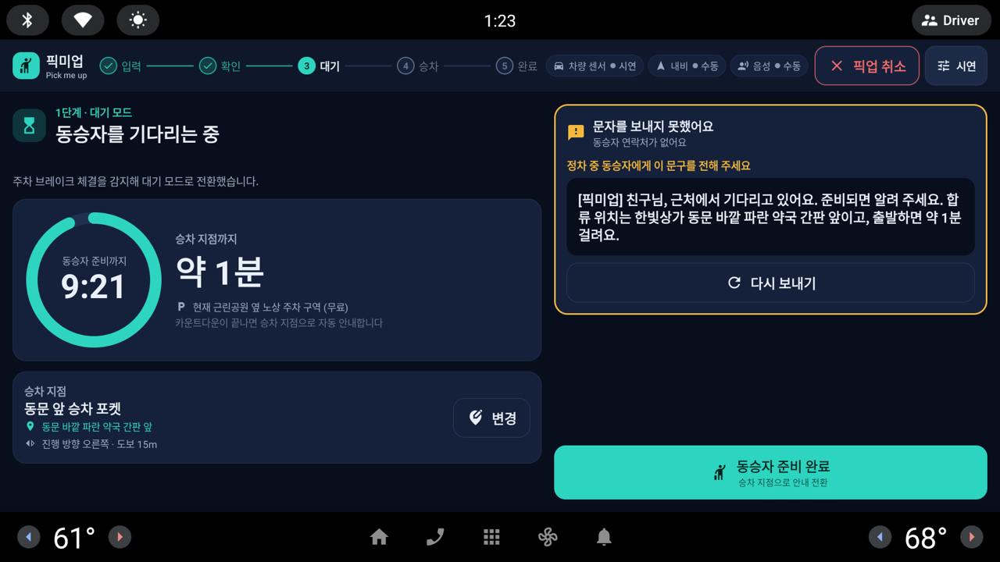

# 픽미업 (Pick me up)

> 동승자를 데리러 갈 때 무료 대기 장소를 안내하고, 동승자가 준비되면 차량 진입과 승차가 가능한 지점으로 내비 안내를 전환하는 Pleos Connect 차량용 앱입니다.

현대자동차그룹 차량용 앱 개발 공모전 출품작입니다. 건물 주소 하나뿐이던 픽업 목적지를 **기다리는 곳(대기 장소)** 과 **태우는 곳(승차 지점)** 으로 나누고, 그 사이의 전환을 차량 신호(주차 브레이크·도어)와 Pleos 기본 내비게이션으로 처리합니다.

## 주요 기능

| 기능 | 내용 | 사용 SDK |
| --- | --- | --- |
| 명시적 요청 기반 입력 | 운전자가 마이크 버튼을 누르거나 화면을 터치했을 때만 동작합니다. "한빛상가 동문에서 친구 태울 거야. 10분 정도 걸린대" → 거점·출입구·준비 시간·동승자 조건을 해석합니다. | SpeechToText |
| 4단계 우선순위 승차 지점 추천 | ① 주행차로 옆 승차 공간 → ② 건물 앞 외부 승하차 공간 → ③ 노상 주차 구역 → ④ 주차장. 보행 약자는 계단·턱 있는 지점을 제외하고, 짐이 많으면 도보 거리를 더 크게 반영합니다. | — (core 모듈) |
| 교통 상태 반영 재정렬 | 1순위 진입로가 정체면 접근이 원활한 대체 지점을 위로 올리고 이유를 표시합니다. 교통정보가 없는 골목은 `교통정보 없음`으로 표시하고 기본 우선순위를 유지합니다. | — (core 모듈) |
| 대기 장소 안내 | 준비 시간이 10분 이상이면 무료 → 일부 무료 → 유료 순으로 대기 장소를 제안합니다. 10분 미만이거나 이미 나와 있으면 바로 승차 지점으로 안내합니다. | NaviHelper |
| 대기 모드 | 대기 장소에서 주차 브레이크(EPB) 체결을 감지하면 대기 모드로 들어가 동승자 준비 카운트다운과 승차 지점까지 예상 시간을 보여 줍니다. 센서를 못 읽으면 "정차 완료" 버튼으로 진행합니다. | Vehicle |
| 승차 지점 자동 전환 | 동승자 준비 신호(또는 카운트다운 종료)를 받으면 내비 목적지를 승차 지점으로 바꿉니다. | NaviHelper |
| 동승자 알림 | ① 픽미업 서버 문자(설정 시) ② 차량 문자 앱에 합류 안내 채우기 ③ 둘 다 안 되면 화면에 합류 안내 문구를 크게 띄워 정차 중 전달하도록 합니다. | — |
| 탑승 완료 | 승차 지점에서 도어 개폐를 감지하면 완료 알림을 띄웁니다. 센서를 못 읽으면 "탑승 완료" 버튼으로 마칩니다. | Vehicle |
| 음성 안내 | 단계가 바뀔 때 짧은 음성 안내를 합니다. | TextToSpeech |

## APK

- 파일: [`apk/PickMeUp_PickMeUp_release.apk`](apk/PickMeUp_PickMeUp_release.apk) (release 빌드, 서명됨)
- 같은 파일을 [GitHub Release v1.0.0](../../releases/tag/v1.0.0)에도 올려 두었습니다.
- 패키지명: `com.pickmeup.app` · versionName `1.0.0` · minSdk 28 · targetSdk 34

## 실행 방법

### APK로 바로 설치

1. Pleos Connect Emulator를 실행합니다 (아래 "테스트 환경" 참고).
2. APK를 설치합니다.
   ```bash
   adb install -r apk/PickMeUp_PickMeUp_release.apk
   ```
3. 에뮬레이터 앱 목록에서 **픽미업**을 실행합니다.

### 소스에서 빌드

```bash
git clone <이 저장소 주소>
cd pickmeup-app
./gradlew :core:test            # 도메인 로직 단위 테스트
./gradlew :app:assembleDebug    # 디버그 APK
./gradlew :app:assembleRelease  # release APK (서명 키가 없으면 debug 키로 서명)
```

- JDK 17, Android SDK Platform 34가 필요합니다. Android Studio에서 프로젝트 폴더를 열어 실행해도 됩니다.
- Pleos Connect SDK는 `settings.gradle.kts`에 등록된 Pleos Maven 저장소(`https://nexus-playground.pleos.ai/repository/maven-releases/`)에서 받습니다.

### 시연 순서 (약 2분)

화면 오른쪽 위 **시연 패널**에서 차량 신호와 교통 상태를 직접 바꿀 수 있어, 실제 차량이나 Virtual Console 없이도 전체 흐름을 볼 수 있습니다.

1. 홈에서 시연 문장 **"상가 동문에서 친구 태울 거야. 10분 정도 걸린대"** 를 누릅니다 (또는 마이크 버튼으로 말하기).
2. 거점 후보(한빛상가 / 누리학원가) 중 한빛상가를 고르면 승차 지점 순위와 무료 대기 장소가 나옵니다.
3. 시연 패널에서 `LINK-HB-01`을 **정체**로 바꾸면 1순위 지점이 내려가고 대체 지점이 이유와 함께 올라옵니다.
4. **대기 장소로 안내** → 시연 패널 **주차 브레이크 체결** → 대기 모드(카운트다운, 합류 안내 전송 결과).
5. **동승자 준비 완료** → 승차 지점으로 내비 전환 → **도착** → 시연 패널 **도어 열림** → 탑승 완료.

다른 시연 문장:
- "한빛상가 동문에서 친구 태울 거야. 3분쯤 걸린대" — 대기 없이 바로 승차 지점 안내
- "새솔병원 정문에서 할머니 모시고 갈게. 휠체어 타셔. 십 분 정도 걸린대" — 보행 약자 조건(계단·턱 지점 제외)
- "누리학원가 후문, 딸이 이미 나와 있대" — 동승자가 이미 나와 있는 경우

## 테스트 환경 및 필요한 설정

| 항목 | 값 |
| --- | --- |
| 대상 에뮬레이터 | **Pleos Connect Emulator v2.1.0** (system image `system-images;android-34;pleos_car_emulator`, Android 14 / API 34) |
| 대상 SDK | Pleos Connect SDK — Vehicle 2.3.2, NaviHelper 3.0.5, SpeechToText 3.3.1, TextToSpeech 3.3.1 |
| 화면 규격 | **1920 × 1080 px, 160 dpi (가로형, 1920 × 1080 dp)** 에서 화면 검증. 1000dp·1600dp 기준 반응형 레이아웃이라 세로형·멀티 윈도우에서도 1단으로 재배치됩니다. |
| 동작 검증 환경 | Android Automotive 에뮬레이터 (API 33, arm64, 1920 × 1080 / 160 dpi) — 위 시연 순서 전체(대기 장소 경유, 진입로 정체 재정렬, 탑승 완료)를 크래시 없이 확인. 이 환경에는 Pleos 서비스가 없어 SDK는 `수동` 상태로 표시되고 시연 패널·수동 버튼으로 진행됩니다. |
| AVD 권장 설정 | Automotive 디바이스, Cold boot, RAM 4 GB (Pleos 개발 가이드 권장값) |
| 빌드 도구 | Android Gradle Plugin 8.5.2, Gradle 8.9, Kotlin 1.9.25, JDK 17, Jetpack Compose (Material 3) |

### 화면 구성

- 차량 디스플레이 가로 화면 기준 좌우 2단 레이아웃(왼쪽 요청 정보 · 오른쪽 후보 목록)입니다.
- 주행 중 주의 분산을 줄이기 위해 터치 영역은 76dp 이상, 주요 버튼은 화면당 1~2개로 제한하고, 주행 중(주차 브레이크 해제 확인 시) 키보드 입력과 문자 앱 전환을 막습니다.

| 홈 (음성·터치 입력) | 확인 (대기 장소·승차 지점) |
| --- | --- |
|  |  |
| **진입로 정체 → 순위 조정** | **대기 모드 (EPB 감지)** |
|  |  |
| **탑승 완료 (도어 감지)** | |
|  | |

### 선택 설정 (없어도 실행됨)

비밀값은 저장소에 포함하지 않았습니다. 필요하면 프로젝트 루트에 `secrets.properties`를 만들어 넣습니다(`.gitignore` 대상).

```properties
# Pleos Playground > My Project > SDK 클라이언트 ID·시크릿 (서버 음성 인식·합성용)
PLEOS_CLIENT_ID=
PLEOS_CLIENT_SECRET=
# 동승자 알림용 픽미업 문자 서버 (POST {"to": "...", "text": "..."})
SMS_SERVER_URL=
```

- 클라이언트 ID가 없으면 음성 인식·합성은 차량 내장(ON_DEVICE) 모드로 동작하고, 그마저 안 되면 화면 터치 입력으로 진행합니다.
- 문자 서버 주소가 없으면 차량 문자 앱에 합류 안내를 채워 열고, 연락처가 없으면 화면에 합류 안내 문구를 띄웁니다.
- 자체 서버 소스는 제출 범위에 포함하지 않았습니다.

### 권한

| 권한 | 용도 |
| --- | --- |
| `pleos.car.permission.CAR_DOORS` | 도어 개폐 감지 (탑승 완료) |
| `pleos.car.permission.CAR_SAFETY` | 경고등 정보로 주차 브레이크(EPB) 체결 감지 (대기 모드) |
| `pleos.car.permission.NAVI_ROUTE_SEARCH` | Pleos 기본 내비 목적지 설정·취소 |
| `pleos.car.permission.NAVI_ROUTE` | 경로·도착 이벤트 수신 보강 |
| `pleos.car.permission.STT_SERVICE` / `TTS_SERVICE` | 음성 인식·음성 안내 |
| `android.permission.INTERNET` | 픽미업 문자 서버(선택) |

마이크는 Pleos Speech Service가 사용하므로 앱은 `RECORD_AUDIO`를 요청하지 않고, 차량 마이크 음성을 외부 음성 인식 서비스로 보내지 않습니다. 문자 발송 권한(`SEND_SMS`)도 쓰지 않습니다.

## 구조

```
core/   순수 Kotlin — 거점·승차 지점 데이터, 4단계 우선순위 추천, 음성 문장 해석, 픽업 상태 머신, 합류 안내 문구 (단위 테스트 포함)
app/    Android — Compose 차량 화면, Pleos SDK 어댑터(platform/pleos), 동승자 알림
apk/    release APK
docs/   ARCHITECTURE.md
```

자세한 구조와 픽업 상태 흐름은 [docs/ARCHITECTURE.md](docs/ARCHITECTURE.md)를 참고하세요.

## 알려진 제약

- 거점·승차 지점 데이터(한빛상가, 새솔병원, 누리학원가)는 **시연용 가상 샘플 데이터**이며 현장 확인을 거치지 않았습니다. 실제 서비스에서는 지자체 도로·주차장 공공데이터와 현장 확인으로 구축합니다.
- 공개 SDK에 실시간 교통정보 API가 없어, 시연에서는 접근 도로별 소통 상태를 시연 패널로 설정합니다.
- Vehicle SDK 2.3.2에는 주차 브레이크 상태 API가 따로 없어 경고등(`ELECTRONIC_PARKING_BRAKE`) 정보로 판단하며, 1초 간격으로 조회합니다.
- 동승자의 "준비 완료" 신호는 시연에서 버튼과 카운트다운으로 대신합니다.
- 주행 중 사용 선언(Distraction Optimized)은 하지 않았습니다. 주행 중에는 플랫폼 주행 규제 정책을 따르며, CarUxRestrictions 연동 후 선언할 계획입니다.
